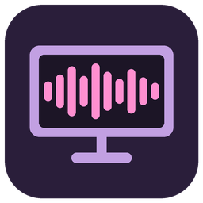
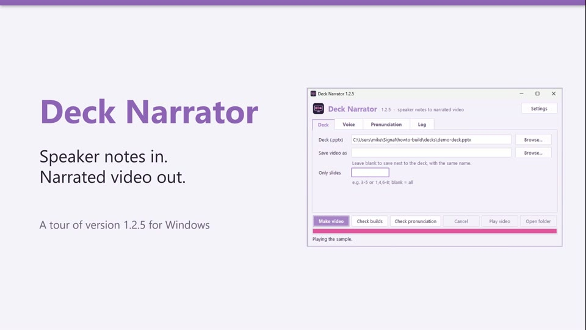

<h1 align="center">Deck Narrator</h1>

Turns the speaker notes in a PowerPoint deck into a narrated video. 
Free. Runs on your own computer. Nothing is uploaded.

**Watch the how-to (8 minutes):** a tour of the app, narrated by Deck Narrator itself.

## Install

Pick your computer. Each link opens a short, step-by-step page.

> **Tip:** to keep this page open too, hold **Ctrl** (or **⌘ Cmd** on a Mac) while you
> click a link. It opens in a new tab. (GitHub doesn't let a page open links in a new window
> by itself.)

<table>
<tr>
<td align="center" width="33%"><a href="docs/WINDOWS.md"> <b>Windows</b></a> Windows 10 or 11</td>
<td align="center" width="33%"><a href="docs/MAC.md"> <b>Mac</b></a> Apple Silicon (M1 or newer)</td>
<td align="center" width="33%"><a href="docs/LINUX.md"> <b>Linux</b></a> Debian, Ubuntu and others</td>
</tr>
</table>

## Make a video

1. In PowerPoint, type what should be said in each slide's **speaker notes** (View > Notes).
2. Open Deck Narrator, click **Browse...** and pick the deck.
3. Click **Make video**. The video is saved next to the deck, with the same name.

## For the best results, let an AI write the notes

**The best videos come from having an AI chatbot (ChatGPT, Claude, Copilot, Gemini) write
the speaker notes and handle the pronunciations.** It turns bullets into natural speech,
puts each `[click]` where an animation happens, and respells names the voice would trip on.
**[Let an AI write your notes](docs/AI-NOTES.md)** has a prompt you can copy and paste.

## Help

- **[How to fix pronunciations](docs/PRONUNCIATION.md):** when the voice says a word wrong.
- **[Using Deck Narrator](docs/GUIDE.md):** the window, writing good notes, animations,
  more than one voice, and what error messages mean.
- **[Your own voice](docs/OWN-VOICE.md):** narrate in your voice, from a 20-second recording.
- **[Reference](docs/REFERENCE.md):** the command line, every option, and the technical details.
- **Something not working?** [Open an issue](https://github.com/mikesimone/deck-narrator/issues).

## Tip jar

Deck Narrator is free. If it saves you time, a tip keeps it going:

## Privacy

Your decks, notes and videos never leave your computer, and Deck Narrator collects nothing
about you. It goes online only to download voices, to check for updates (both can be
turned off), and to fetch LibreOffice or your-own-voice support if you ask it to. [Details](docs/REFERENCE.md#privacy).

## License

MIT for this repository's code (`LICENSE`). The Windows standalone zip bundles third-party
packages, including GPL-3.0 ones, and is distributed under the GPL-3.0 as a whole; see
`THIRD-PARTY-NOTICES.md`. The Kokoro-82M voice model
([hexgrad/Kokoro-82M](https://huggingface.co/hexgrad/Kokoro-82M)) is Apache-2.0.
