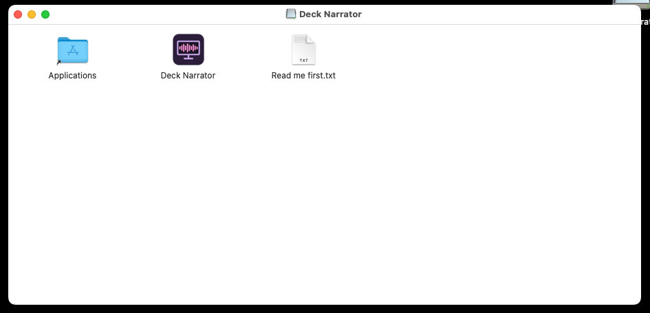
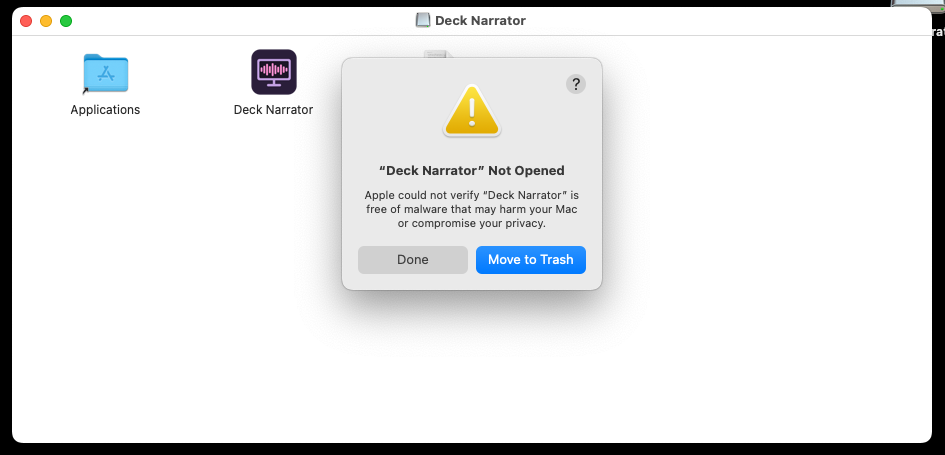
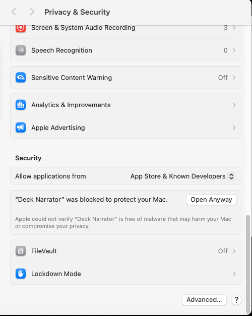
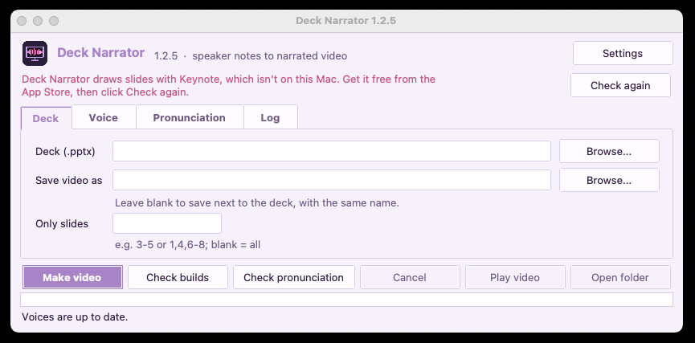

# Deck Narrator on a Mac

Deck Narrator turns the speaker notes in a PowerPoint file into a narrated video. This page
walks you through installing it on a Mac, one step at a time. It takes about five minutes.

**You need:** a Mac with Apple Silicon (M1, M2, M3, M4 or newer; any Mac from late 2020 on)
running macOS 12 or newer, and Keynote (free; it's already on most Macs).

> Not sure which chip your Mac has? Click the Apple menu  in the top-left corner, then
> **About This Mac**. Next to **Chip** it says Apple M1, M2, M3 or M4. If it says Intel,
> this version won't run on your Mac.

## 1. Download it

Go to the [Releases page](https://github.com/mikesimone/deck-narrator/releases/latest) and
click the file whose name ends in **`-mac-arm64.dmg`**. It's big (several hundred MB),
because the voices are included so nothing is sent over the internet when you use it.

## 2. Copy it to Applications

Open the downloaded file (it's in your **Downloads** folder). A window opens. Drag the
**Deck Narrator** icon onto the **Applications** folder in the same window.

## 3. Open it the first time

Open your **Applications** folder and double-click **Deck Narrator**.

The first time, your Mac stops it with a message like *"Deck Narrator" Not Opened* or
*Apple could not verify "Deck Narrator" is free of malware*. That's expected. Click
**Done**. **Don't** click **Move to Trash**.

Why it happens: Apple charges developers a yearly fee to register their apps. Deck Narrator
is a free project that doesn't pay it. It's built in public from this website's source code
by GitHub, not on anyone's computer.

## 4. Allow it, once

1. Click the Apple menu , then **System Settings**.
2. Click **Privacy & Security** in the list on the left.
3. Scroll all the way down. Under **Security** it says *"Deck Narrator" was blocked to
   protect your Mac*. Click **Open Anyway**.

4. Your Mac asks again. Click **Open Anyway**, then type your Mac password (the one you
   use to log in) if it asks.

That's it. From now on Deck Narrator opens with a normal double-click, and you can keep it
in your Dock: while it's open, right-click its icon in the Dock and choose
**Options > Keep in Dock**.

## 5. Make your first video

If a red line at the top says Keynote isn't on this Mac, get Keynote free from the
App Store, then click **Check again**.

1. Click **Browse** and pick your PowerPoint file (.pptx).
2. Click **Make video**.
3. The first time, your Mac asks *"Deck Narrator" wants access to control "Keynote"*.
   Click **Allow** (or **OK**). Deck Narrator uses Keynote to draw your slides, and
   it closes Keynote again when it's done.

The video is saved next to your PowerPoint file, with the same name ending in `.mp4`.

The [how-to video](../README.md) and [Using Deck Narrator](GUIDE.md) explain the other
options: picking a voice, slide animations and more. For words it says wrong, see [Fixing
pronunciation](PRONUNCIATION.md). For the best results, [let an AI write your
notes](AI-NOTES.md).

## If something goes wrong

| What you see | What to do |
|---|---|
| *"Deck Narrator" is damaged and can't be opened* | The download didn't finish. Delete it, download it again, and repeat from step 2. |
| No **Open Anyway** button in step 4 | It only appears for about an hour after step 3. Double-click Deck Narrator again, click **Done**, and go back to Privacy & Security. |
| *Your organization* or *your administrator* blocks it | Your company manages your Mac and doesn't allow apps from outside the App Store. Ask your IT team to allow it. |
| *Keynote export failed* | Open **System Settings > Privacy & Security > Automation**, find **Deck Narrator**, and turn on **Keynote**. If Keynote isn't installed, get it free from the App Store. |
| It's slow | The first video after starting the app takes longer while the voice loads. On Apple Silicon it uses the Mac's graphics chip, so later ones are quicker. |

Something else? [Open an issue](https://github.com/mikesimone/deck-narrator/issues) with a
screenshot of the message.
